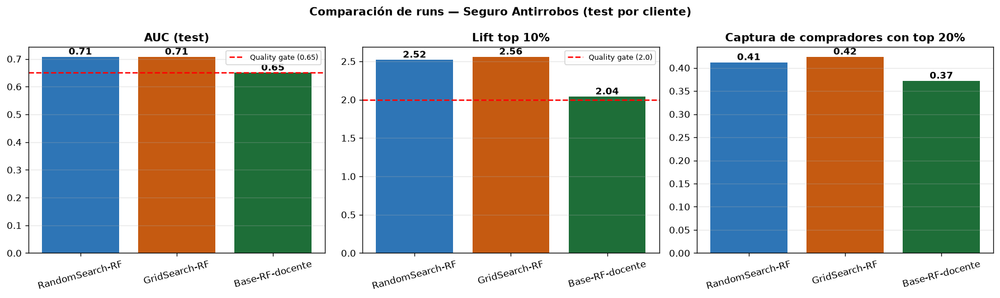

# Venta de Seguros Antirrobos — Proyecto Final MLOps

**Alumno:** Rody Josue Ccoyllo Cule
**Curso:** MLOps: Del Modelo al Entorno Productivo (4ta edición, Smart Data)

Pipeline MLOps end-to-end que prioriza a qué clientes de la financiera ofrecer un
seguro de protección post-robo (billetera S/50, celular S/350, laptop S/680):
datos versionados → entrenamiento reproducible → tracking y registro en MLflow →
API con FastAPI en Docker.

---

## 1. Problema de negocio

| | |
|---|---|
| **Pregunta** | ¿A qué clientes conviene ofrecer el seguro primero? |
| **Tipo de modelo** | Clasificación binaria → `FLAG_SS` (1 = compró). Se usa como **score para ordenar** clientes |
| **Datos** | 28,313 filas · 2.6% de compradores (muy desbalanceado) |
| **Métrica principal** | **AUC** (capacidad de ordenar) + **lift / captura en el top 10–20%** (lenguaje de campaña) |
| **Por qué no accuracy** | Decir "nadie compra" ya acierta 97.4% y no sirve para nada |

## 2. Resultados

| Run (MLflow) | AUC test | Lift top 10% | Captura con top 20% | Quality gate |
|---|---|---|---|---|
| **RandomSearch-RF** → *Staging* | **0.708** | **2.52×** | **41%** | ✅ |
| GridSearch-RF | 0.708 | 2.56× | 42% | ✅ |
| Base-RF-docente (sin tuning) | 0.650 | 2.04× | 37% | ✅ (al límite) |

**Lectura de negocio:** si la campaña llama solo al **20%** de clientes que prioriza el
modelo, alcanza al **41% de los compradores**. El top 10% compra **2.5 veces** más que el promedio.



## 3. Arquitectura

```
data/raw/*.csv (DVC)
  → 01_ingest         limpieza mínima, cliente_id, split POR CLIENTE, validación
  → 02_base_pipeline  RF del notebook del docente, sin tuning        → Run 0 (MLflow)
  → 03_gridsearch / 04_randomsearch  tuning con CV por cliente        → Runs 1-2
  → 05_comparar_runs  tabla + gráfico (mlflow.search_runs)
  → 06_mejor_modelo   QUALITY GATE (AUC ≥ 0.65 y lift ≥ 2.0) → si falla, se detiene
  → 07_model_registry Staging + alias @champion → exporta artifacts/modelo.pkl
        → api/ (FastAPI) → Docker → POST /predecir {score, prioridad, acción}
```

| Unidad del curso | Dónde está en este repo |
|---|---|
| U1 Repositorio | Git + ramas `develop` / `main`, `.gitignore` |
| U2 Código modular, logging, pytest | `pipeline/*.py`, `tests/` (18 tests) |
| U3 DVC + MLflow | `data/raw/*.csv.dvc`, `mlflow.db` |
| U4 Pipeline por etapas + validación | `config.py`, `validar_salida()`, `run_pipeline.py` |
| U5 FastAPI + Docker | `api/`, `Dockerfile`, `docker-compose.yml` |
| U6 Tuning + MLflow Registry | etapas 03 a 07 |

## 4. Decisiones clave (y por qué)

1. **Un solo Pipeline de scikit-learn (imputación + one-hot + modelo).** La API recibe
   datos crudos y aplica exactamente la misma transformación del entrenamiento. Evita el
   *training-serving skew* que en la U5 obligó a reescribir el preprocesamiento a mano.
2. **Split por cliente.** El CSV no trae ID y el mismo cliente aparece en varias filas
   (fotos mensuales). Con split aleatorio el modelo "memoriza" clientes: el RF del notebook
   original mostraba precisión 0.89–0.99, que cae a recall 0 con clientes nuevos.
   Se crea `cliente_id` y se usa `StratifiedGroupKFold` en el split y en la validación cruzada.
3. **`class_weight` en lugar de SMOTE.** SMOTE antes de la validación cruzada mete puntos
   sintéticos en los folds e infla las métricas.
4. **Variables excluidas:** `FLAG_UNICEF` (no está en el diccionario), `FLAG_LIMA_PROVINCIA`
   (100% redundante con `REGION`) y `SEXO` (equidad: quitarla cuesta solo −0.004 de AUC).
5. **Quality gate fijado antes de entrenar** (AUC ≥ 0.65 y lift top 10% ≥ 2.0). Si el mejor
   modelo no lo cumple, el pipeline termina con error y nada llega al Registry.
6. **Prioridad ALTA/MEDIA/BAJA con cortes calculados en datos** (top 10% y siguiente 20%
   del test), guardados en `artifacts/metrics.json`.

## 5. Cómo reproducirlo (GitHub Codespaces)

```bash
# Entorno
python -m venv .venv && source .venv/bin/activate
pip install -r requirements.txt

# Pipeline completo (~4 min): 7 etapas, se detiene si alguna falla
python run_pipeline.py

# Tests (18): ingesta + API
pytest -v

# MLflow UI (pestaña Puertos → 5000)
mlflow ui --backend-store-uri sqlite:///mlflow.db --host 0.0.0.0 --port 5000 \
  --allowed-hosts "localhost:*,127.0.0.1:*,*.app.github.dev"

# API en Docker (pestaña Puertos → 8000 → /docs)
docker compose up --build
```

## 6. Uso de la API

`POST /predecir`
```json
{
  "Mto_TC": 3000, "SUELDO_ESTIMADO": 1500, "EDAD": 32, "ANTIGUEDAD_MES": 35,
  "Nombre_territorio": "T.NOR ORIENTE", "REGION": "ORIENTE",
  "SEGMENTO": "BAJO VALOR", "MARCA": "Visa"
}
```
Respuesta:
```json
{
  "score_propension": 0.7585,
  "prioridad": "ALTA",
  "accion_sugerida": "Contacto prioritario: llamada del asesor + SMS",
  "modelo": "RandomForest (Pipeline sklearn)",
  "version_modelo": "RandomSearch-RF"
}
```
- Acepta campos vacíos (los imputa el Pipeline) y territorios no vistos.
- Valida rangos: edad < 18 o monto negativo → HTTP 422.
- `GET /health` devuelve el estado y las métricas del modelo en servicio.

## 7. Estructura

```
├── config.py              # rutas, columnas, parámetros y umbrales (único lugar)
├── run_pipeline.py        # orquestador de las 7 etapas
├── pipeline/              # 01_ingest … 07_model_registry + utils.py
├── api/                   # schemas.py · predictor.py · app.py
├── tests/                 # test_ingest.py · test_api.py
├── data/raw/              # dataset versionado con DVC (*.csv.dvc)
├── artifacts/             # métricas, gráfico de runs, modelo exportado
├── notebooks/ references/ # material original del docente
├── Dockerfile · docker-compose.yml · requirements*.txt
```

